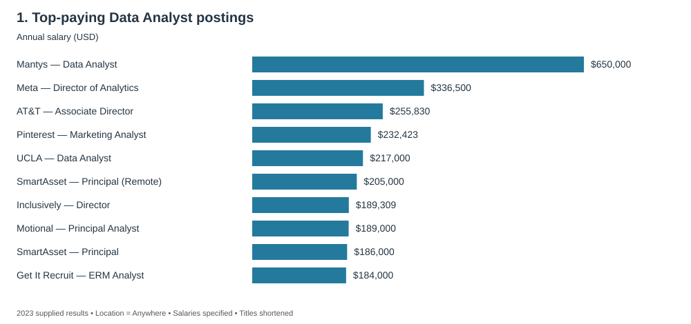
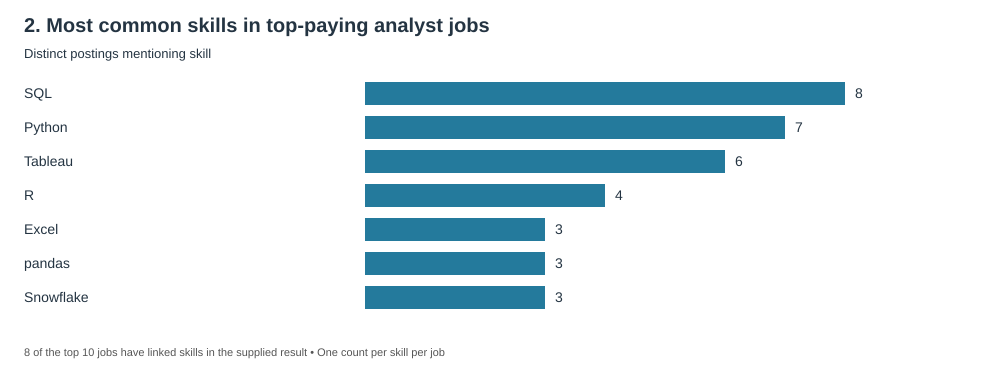
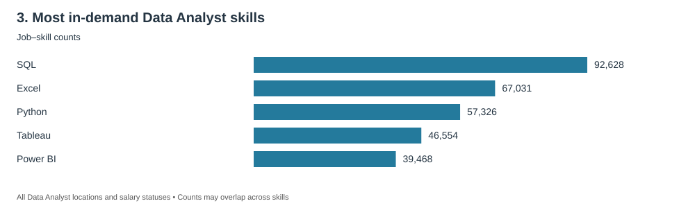
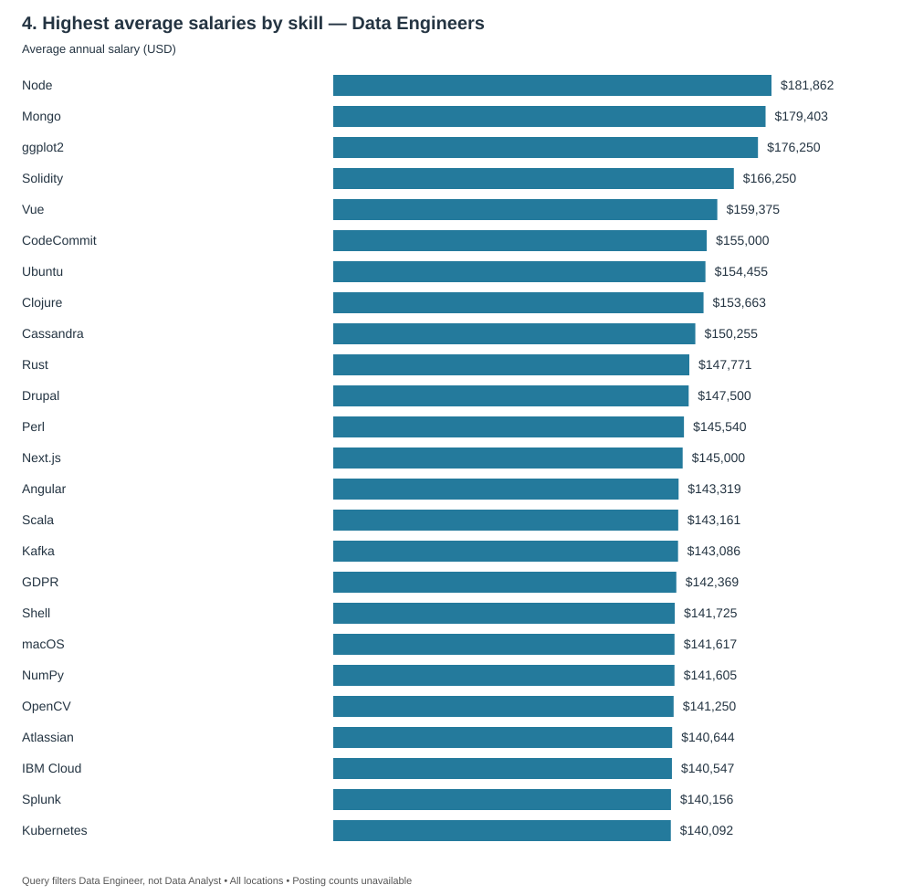
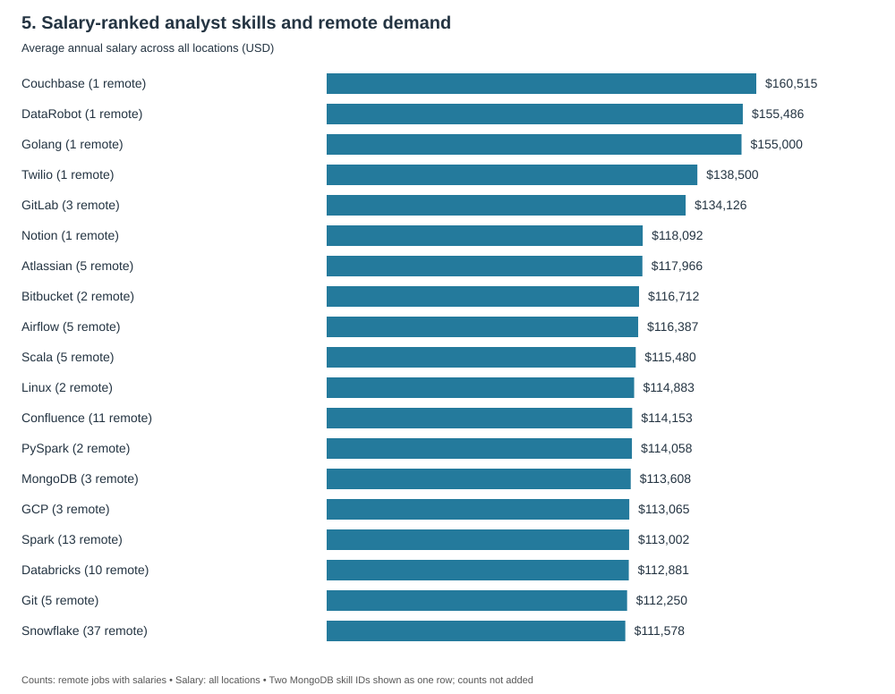

# Introduction
📊Dive into the data job market! Focusing on data analyst roles, this project explores, 🤑 top-paying jobs, 🔥 in-demand skills, and 📈 where high demand meets high salary in data analytics. 

🔍 SQl queries? Check them out here : [project_sql folder](/project_sql/)

# Background
Driven by a quest to navigate the data analyst job market mroe effectively, this project was born from a desire to pinpoint top-paid and in-demand skills, streamlining others work to find optimaljobs.

### Questions i wanted to answer through my SQl queries were:
1. What are top-paying data analyst jopbs?
2. What skills are required for these top-paying jobs.
3.What skills are most in demand for data analysts?
4. Whcih skills are associated with higher salaries?
5. What are most optimal skills to learn?

# Tools I Used
For mt deep dive into the data analyst job market, I exlpored the power of several key tools:

- **SQL**: The backbone of my analysis, allowing me to query the database and unearth critical insights.
- **PostgresSQL**: The chosen database management system, ideal for handling the job posting data.
- **VS Code**: My go-to for database management and executing the SQL queries.
- **Git & GitHub**: Essential for version control and sharing my SQL scripts and analysis, ensuring collaboration and project tracking.

# The Analysis
Each query for this project aimed t investigating specific aspects of the data analyst job market. 
Here's how i approached each question:

### 1. Top-paying Data Analyst jobs
```SQL
select 
    f.job_id,
    f.job_title,
    f.job_location,
    f.job_schedule_type,
    f.salary_year_avg,
    f.job_posted_date,
    d.name as company_name
from job_postings_fact f
left join company_dim d 
    on f.company_id = d.company_id
where f.job_title_short = 'Data Analyst'
    AND f.job_location = 'Anywhere'
    AND f.salary_year_avg is not null
order by f.salary_year_avg desc
limit 10;
```
- Salaries range from **$184,000 to $650,000** across the top 10 postings.
- **Mantys ($650,000)** is an outlier, at nearly twice Meta's $336,500.
- **Six titles include Director or Principal**, highlighting senior roles.


*Bar graph visualizing: Chatgpt generated this graph from my SQL query results*

### 2. Skills for top-paying jobs
```SQL
with top_paying_jobs as (
    select 
        f.job_id,
        f.job_title,
        f.salary_year_avg,
        c.name as company_name
    from job_postings_fact f
    left join company_dim c 
        on f.company_id = c.company_id
    where f.job_title_short = 'Data Analyst'
        AND f.job_location = 'Anywhere'
        AND f.salary_year_avg is not null
    order by f.salary_year_avg desc
    limit 10 
)
select 
    t.*,
    s.skills
from top_paying_jobs t
inner join skills_job_dim d
    on t.job_id = d.job_id
inner join skills_dim s
    on s.skill_id = d.skill_id
order by t.salary_year_avg desc;
```
- **SQL: 8 postings; Python: 7; Tableau: 6.**
- **SQL, Python, and Tableau appear together in 5 of 8 postings.**
- Only **8 of the top 10 jobs** have linked skills in the result; percentages use those 8.


*Bar graph visualizing: Chatgpt generated this graph from my SQL query results*

### 3. Most in-demand Data Analyst skills
```SQL
select
    s.skill_id,
    s.skills,
    count(d.job_id) as job_counts
from skills_dim s
inner join skills_job_dim d
    on s.skill_id = d.skill_id
inner join job_postings_fact f
    on d.job_id = f.job_id
where job_title_short = 'Data Analyst'
Group by s.skill_id, s.skills 
order by  count(d.job_id) desc
limit 5
```
- **SQL leads with 92,628 records**, 38% more than Excel.
- **Excel (67,031) ranks ahead of Python (57,326).**
- **Tableau (46,554) exceeds Power BI (39,468) by 18%.**


*Bar graph visualizing: Chatgpt generated this graph from my SQL query results*

### 4. Highest-paying Data Engineer skills
```SQL
select
    s.skills,
    Round(avg(f.salary_year_avg),0) as average_salary
from skills_dim s
inner join skills_job_dim d
    on s.skill_id = d.skill_id
inner join job_postings_fact f
    on d.job_id = f.job_id
where job_title_short = 'Data Engineer'
AND f.salary_year_avg is not null
Group by s.skills 
order by average_salary Desc
limit 25

```
- **Node ($181,862), Mongo ($179,403), and ggplot2 ($176,250)** lead.
- **Cassandra, Scala, and Kafka** feature among the top 25.
- The query filters **Data Engineers**, not Data Analysts; posting counts are unavailable.


*Bar graph visualizing: Chatgpt generated this graph from my SQL query results*

### 5. Skills combining salary and demand
```SQL
with skills_demand as (
    select
        s.skill_id,
        s.skills,
        count(d.job_id) as job_counts
    from skills_dim s
    inner join skills_job_dim d
        on s.skill_id = d.skill_id
    inner join job_postings_fact f
        on d.job_id = f.job_id
    where job_title_short = 'Data Analyst'
        AND salary_year_avg is not null
        And job_work_from_home = True
    Group by s.skill_id
 
),
average_salary as (
    select
        s.skill_id,
        s.skills,
        Round(avg(f.salary_year_avg),0) as avg_salary
    from skills_dim s
    inner join skills_job_dim d
        on s.skill_id = d.skill_id
    inner join job_postings_fact f
        on d.job_id = f.job_id
    where job_title_short = 'Data Analyst'
        AND f.salary_year_avg is not null
    Group by s.skill_id
   
)
select 
    skills_demand.skill_id,
    skills_demand.skills,
    skills_demand.job_counts,
    average_salary.avg_salary
from skills_demand
inner join average_salary
    on skills_demand.skill_id = average_salary.skill_id
order by  avg_salary desc,
        job_counts Desc
       
limit 20;
```
- **Couchbase, DataRobot, and Golang** lead salary rankings, but each has just **1 remote salary-listed posting**.
- **Snowflake leads demand among returned skills: 37 remote postings**, with an all-location average salary of **$111,578**.
- The query ranks **salary first** and mixes remote demand with all-location salaries; it does not yet establish optimal skills.


*Bar graph visualizing: Chatgpt generated this graph from my SQL query results*

*Notes: Findings describe the supplied 2023 results, not skill-driven salary premiums. Q1 uses the Anywhere location field; Q3 covers all locations. Q5 displays the two identical MongoDB rows once without combining counts.*

# What i Learned

This project strengthened my SQL skills and helped me turn job-posting data into clear insights:

- **🧩 Complex Queries:** Used JOINs and CTEs to combine tables and organize multi-step analysis.
- **📊 Data Aggregation:** Applied GROUP BY, COUNT(), and AVG() to uncover skill demand and salary patterns.
- **🔍 Analytical Thinking:** Turned career questions into SQL queries and interpreted the results.
- **📈 Data Storytelling:** Created charts and concise summaries to communicate findings.
- **💡 Critical Evaluation:** Recognized how outliers, missing data, and query filters influence conclusions.
# Conclusions
### Insights 
1. **Top-paying jobs:** Senior Data Analyst roles featured prominently among the highest-paying postings.
2. **Skills for top-paying jobs:** SQL, Python, and Tableau were the most common skills.
3. **In-demand skills:** SQL led demand, followed by Excel and Python.
4. **Highest-paying skills:** Node, Mongo, and ggplot2 topped the Data Engineer salary ranking.
5. **Salary and demand:** Snowflake had the highest remote demand among the returned skills, while salary leaders had very few remote postings.

### Summary 
This project helped me strengthen my SQL skills while exploring real job-market data. I learned to consider salary, skill demand, and data limitations together when interpreting career opportunities. These findings provide a useful starting point for further learning and analysis.